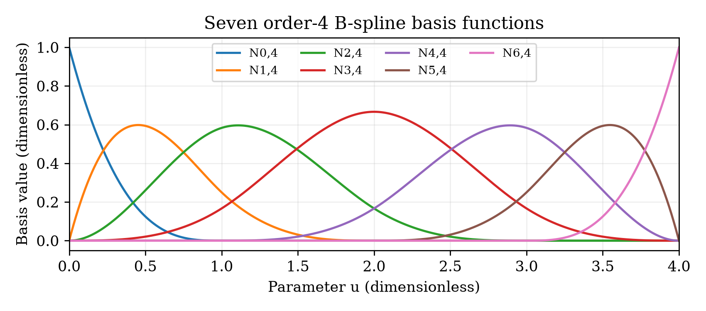
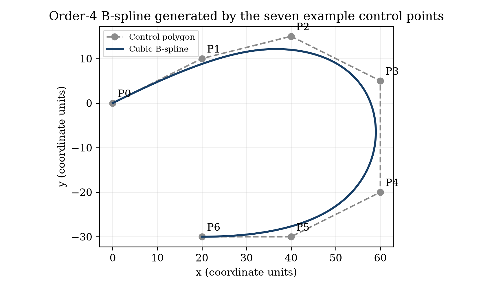

# 三次 B 样条学习示例

从个人 CAD 学习目录中的 Python 示例整理而来，原包注明使用 AI 辅助。本目录保留曲线计算程序，不包含教师课件、完整作业题面、提交 PDF、姓名、学号或邮件地址。示例用于理解算法，不是课程官方答案。

## 运行

需要 Python 3、NumPy 和 Matplotlib。推荐在独立虚拟环境中运行：

```sh
python -m venv .venv
# Windows: .venv\Scripts\activate
# macOS/Linux: source .venv/bin/activate
python -m pip install -r requirements.txt
python cad_bspline.py
```

输出写入脚本所在目录：`bspline_basis.png`、`bspline_curve.png` 和 `curve_samples.csv`。图像使用无界面的 Agg 后端，不需要 CATIA。重复运行会覆盖这三个输出文件。

## 算法与适用范围

七个二维控制点，次数为 3（阶数为 4），节点向量为 `[0,0,0,0,1,2,3,4,4,4,4]`，参数范围为 `[0,4]`。程序以 Cox–de Boor 递推计算基函数，重复节点对应的零分母项贡献为零。

这是固定夹持节点向量的演示，右端点特别设为最后一个基函数取 1。虽然 `basis` 函数接受节点与次数参数，这个端点分支不适用于任意非夹持节点向量；不要将它直接当作通用样条库。修改示例时也需同步修改采样区间、控制点数量及绘图循环。

程序内检查基函数非负、单位分解、有限数值和两端插值。目录内 `verify_example.py` 另用有理数 de Boor 曲线求值与递推结果交叉比较；验证仅覆盖本示例，不证明任意输入均正确。





## 来源与许可

这是本地学习代码的公开整理版，文件头及图标题改为一般学习示例，未复制原包的身份信息及考试、提交要求。此目录的代码采用 [MIT 许可证](LICENSE)；外部课程或文档的许可不受此声明影响。
